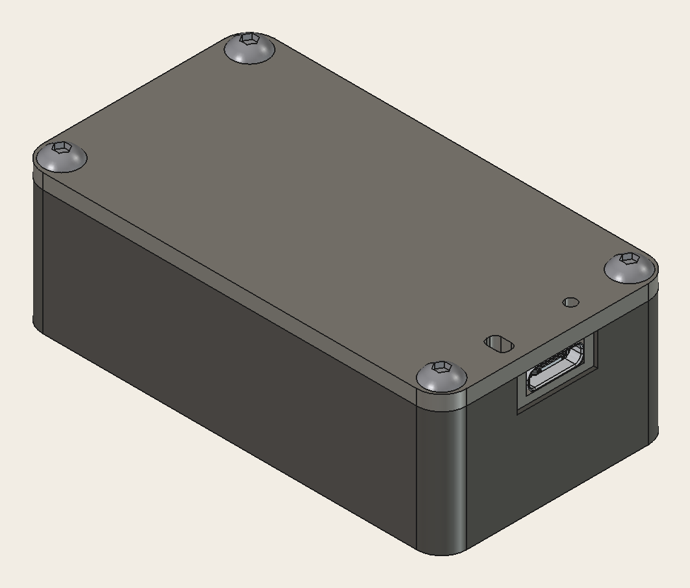
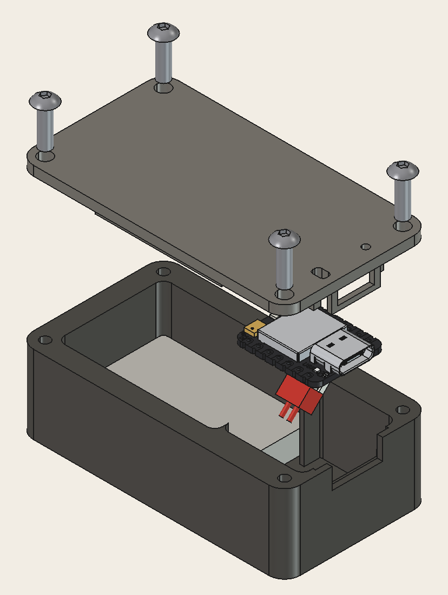
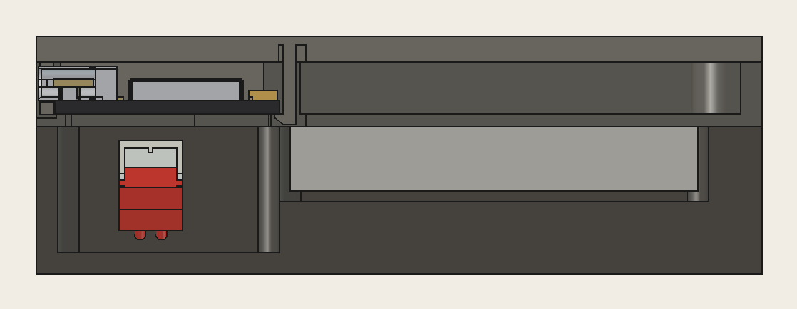
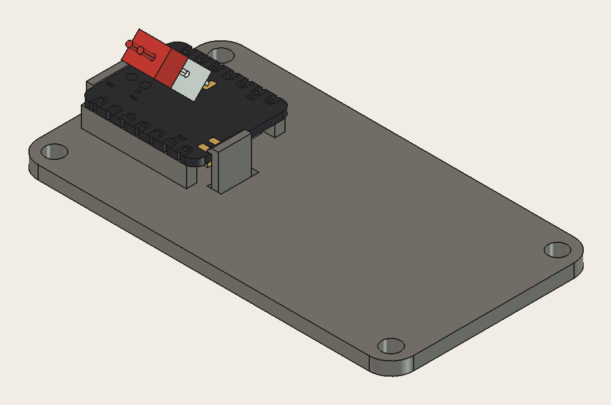

<p align="center">
  
</p>

# FormGuard booth demo

FormGuard helps lifters fix their form without a personal trainer. This repo is the booth demo: small motion sensors strapped to the arm, streaming to a web app that shows the arm in 3D while someone does bicep curls.

<p align="center">
  
</p>

## How it works

1. Each sensor is a **Seeed XIAO nRF52840 Sense** with a 400 mAh LiPo, in a 3D-printed case. Its 6-axis IMU (LSM6DS3, accelerometer and gyro) feeds an orientation filter on the board at about 100 Hz.
2. The board sends its orientation over **Bluetooth LE**, as a quaternion, at about 50 Hz.
3. The **web app** connects with Web Bluetooth and turns those orientations into joint angles. It shows them on a 3D arm.

The app supports three sensor setups:

| Setup | Boards | What it measures |
| --- | --- | --- |
| Forearm only | 1 | Elbow angle and forearm twist |
| Wrist only | 1, worn like a watch | Elbow angle and forearm twist |
| Upper arm + forearm | 2 | Elbow angle, forearm twist and where the elbow drifts to |

## Repo layout

| Folder | What's in it |
| --- | --- |
| [`embedded/`](embedded) | Sensor firmware (PlatformIO, Arduino). Orientation filter, BLE service, calibrate and sleep commands, battery level |
| [`frontend/`](frontend) | Web app (Vite, three.js, Web Bluetooth) and the FormGuard design system |
| [`3d-case/`](3d-case) | The sensor case: FreeCAD script, print files and reference models |

## Getting started

### Flash the sensors

Install [PlatformIO](https://platformio.org/). Then, from `embedded/`:

```bash
pio run -e imu -t upload         # forearm or wrist board, advertises as FormGuard-Fore
pio run -e imu-upper -t upload   # upper arm board, advertises as FormGuard-Upper
```

### Run the web app

```bash
cd frontend
npm install
npm run dev
```

Open the address Vite prints in **Chrome or Edge**. Web Bluetooth isn't supported in Safari or Firefox. Pick a sensor setup, strap the boards on as the app shows, and hold the calibration pose: arm hanging straight, palm facing your thigh.

### Battery and sleep

Each board reports its battery over BLE: voltage, an estimated percentage for the 400 mAh LiPo, and whether it is charging over USB-C. The app shows it as a battery icon with the percentage inside. The Calibrate page shows it next to each sensor. The Live page shows it too, and warns at 20% or below, where the icon turns red.

**Sleep** (on the Calibrate page) or **Sleep sensors** (on the Live page) switches a board off, except the accelerometer. **Double-tap the board** to wake it, then press Connect. RESET also restarts a sleeping board, and double-pressing RESET still enters the UF2 bootloader for flashing.

## The sensor case

<p align="center">
  
</p>

Two printed parts, a base and a lid, held together by four standard M3 × 10 screws, with no inserts or nuts. The outside is **67.7 × 37 × 22.3 mm**.

- **Battery beside the board.** The LiPo lies on the floor at the far end from the USB-C, clear of the board. Two ribs on the lid hold it down. The board's battery socket hangs into a pit underneath the board.
- **USB-C reachable from outside.** You can charge and flash without opening the case.
- **LED window and reset hole** in the lid.
- **Board clips into the lid.** The USB-C hooks into a cradle as a hinge, and a flexible latch clicks over the far end. No tape or tools, and it comes out the same way. With the lid on, the board's corners rest on four fins in the base.

<p align="center">
  
</p>

<p align="center">
  
</p>

Print it in PETG. The lid's latch has to flex, and PLA may crack after many clicks. A PrusaSlicer project for the MK4S is in `3d-case/print-package/` and takes about 1 h 24 min and 28 g for the set, with no supports.

Dimensions, assembly, print settings and how to change the design are in [`3d-case/README.md`](3d-case/README.md).
